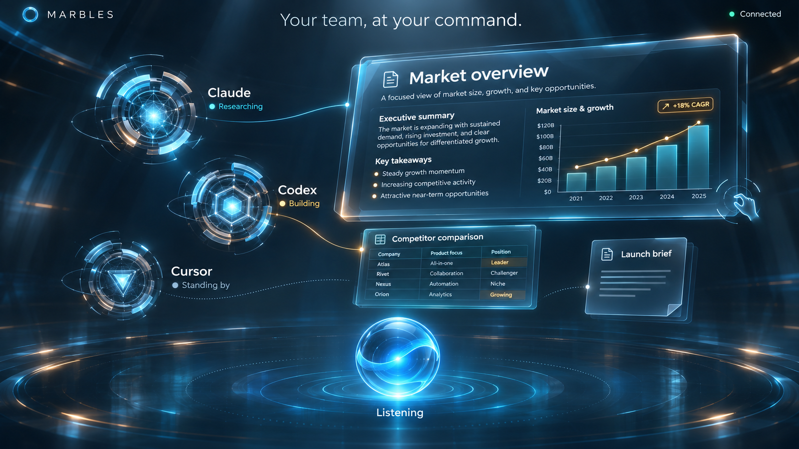
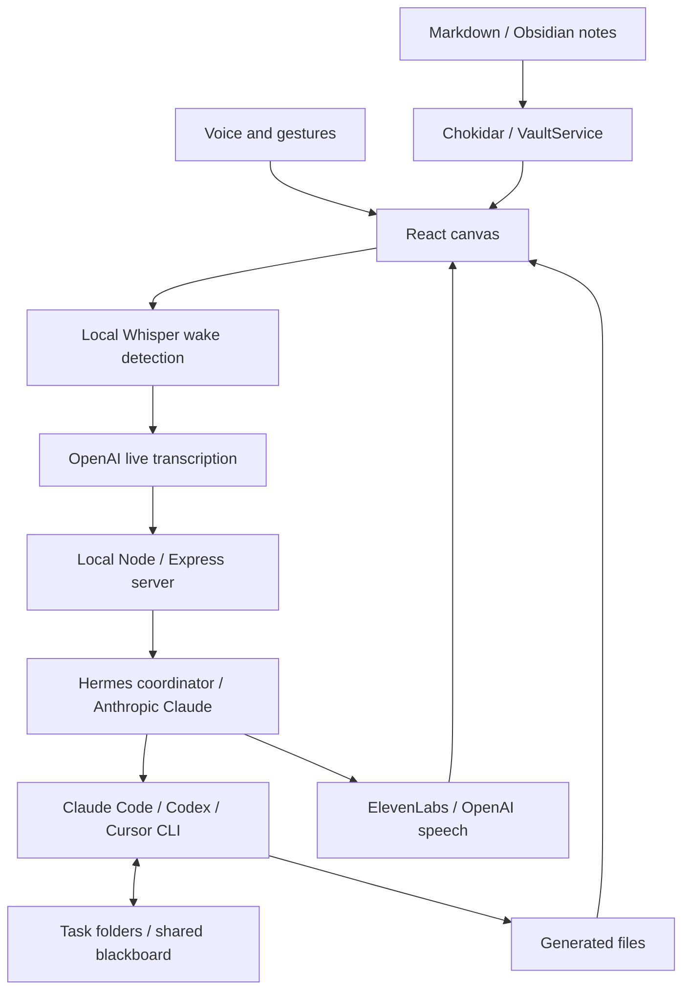

<div align="center">

# Marbles

### Your team. At your command.

A voice and gesture workspace for directing AI agents, following their work, and exploring what they create.

**Speak an outcome · Point to the context · Watch your team deliver**

[Get started](#get-started) · [How to use it](#how-to-use-it) · [Stack](#technology-stack) · [Models & APIs](#models-and-ai-runtime) · [Development](#development)

</div>



<p align="center"><em>The Marbles vision: one canvas for your agents, their progress, and the files they produce. Concept artwork.</em></p>

## The idea

Working with several AI agents often means juggling terminals, repeating context, and hunting for outputs. Marbles brings that work into a shared visual space. You describe what you want, a coordinator chooses how to approach it, and your installed agents do the work while you stay close to the results.

Say “Marbles, prepare a report from these notes.” Select a file and say “use this spreadsheet.” Ask a team to work together, check what Codex is doing, or open a finished presentation without leaving the canvas.

The goal is to make delegation feel natural for everyday work: reports, spreadsheets, research, presentations, and coding. Voice describes the intent; pointing supplies context; visible agents and deliverables show what happened.

Built for the **Imperial AI Society Flagship Hackathon, 14–15 November 2026**, in the Voice, Vision and Generative Media track. This repository is a working local prototype.

## What you can do

| Capability | Experience |
| --- | --- |
| Delegate by voice | Say **Marbles**, then describe an outcome. The coordinator plans and assigns the work. |
| Bring your own agents | Run your installed **Claude Code, Codex, and Cursor CLI** with their existing logins. |
| Work as a team | Ask for collaboration; supported workers share a workspace, a blackboard, and deliverables. |
| Point, pinch, and explore | Select agents and files, drag, pan, and zoom with camera-based hand tracking. Mouse and keyboard remain available. |
| Follow real progress | Inspect task state, recent activity, logs, plans, assumptions, and generated files. |
| Review results in place | Open documents, spreadsheets, slides, PDFs, images, audio, video, and HTML in floating readers. |
| Find media | Request image galleries or YouTube videos and view them on the canvas. |
| Prepare email | Review a draft and confirm sending; optional Nylas integration supports workspace attachments. |
| Connect your notes | Load a Markdown/Obsidian folder, follow links, and see changes as files update. |

### Results become part of the workspace

Finished files appear beside the agent that produced them. New completions can open a floating presentation, with queued results so one agent does not replace the file you are reading. Close the reader to return the agent to its place; the files remain available.

## Get started

### Prerequisites

- **Node.js 22.13+** and npm.
- **Git, uv, and Python 3.14** for the Hermes coordinator runtime.
- **Chrome or Edge**, a microphone, and a webcam for the full voice and gesture experience. Browser folder access and speech capabilities vary across browsers.
- At least one authenticated worker CLI: **`claude`**, **`codex`**, or **`cursor-agent`** / Cursor's **`agent`** command.
- **OpenAI and Anthropic API keys** for the complete voice-to-agent workflow. ElevenLabs and Nylas are optional.

A desktop application being detected does not mean it can execute tasks: the corresponding supported CLI must be installed and authenticated.

### 1. Install the application

```sh
git clone https://github.com/SlaviXG/marbles.git
cd marbles
cp .env.example .env
cd app
npm ci
```

### 2. Configure your local environment

Edit **`.env` in the repository root**, one directory above `app/`:

```dotenv
# Required by the current backend: an existing absolute Markdown folder path.
OBSIDIAN_VAULT_DIR=/absolute/path/to/your/notes

# Command transcription and fallback spoken replies.
OPENAI_API_KEY=your_openai_key

# Hermes coordinator and on-demand visual understanding.
ANTHROPIC_API_KEY=your_anthropic_key

# Optional: preferred spoken replies through ElevenLabs.
ELEVENLABS_API_KEY=

# Optional: where agents create task folders and deliverables.
MARBLES_WORKSPACE_DIR=/absolute/path/to/marbles-workspace
```

The notes folder can be an existing Obsidian vault or an ordinary directory of Markdown files. If you do not have notes yet, create an empty directory and use its absolute path. The current server requires this path even if you only want agent tasks.

Keep real credentials in `.env`; it is ignored by Git. See [`.env.example`](.env.example) for optional configuration.

### 3. Start Marbles

```sh
# From app/
npm run dev
```

Open **[http://localhost:5173](http://localhost:5173)**. The local backend listens on `127.0.0.1:5174`; Vite proxies `/api` requests to it.

The first run downloads the pinned wake model and provisions Hermes in `app/.hermes-runtime/`. Allow time and network access for this setup. Later runs reuse the local assets and installed runtime.

### Just exploring the interface?

```sh
# From app/, after npm ci
npm run client
```

This starts the frontend without requiring a configured vault or Hermes backend. Wake-asset setup still runs on first launch. Agent execution, live server data, and the complete voice workflow need `npm run dev`.

## How to use it

1. **Activate the controls.** Touch the glowing orb and grant microphone and camera permissions. The gesture widget reports tracking state and camera errors.
2. **Wake Marbles.** Say **“Marbles”**, then describe the task. Each new request starts with the wake word.
3. **Give it context.** Select a note, agent, task, team, or output before speaking to refer to that item in your request.
4. **Follow the work.** Open an agent or task to inspect progress, its plan and assumptions, logs, and files.
5. **Review the result.** Select a generated file or use its floating presentation. Say **“Marbles, close the preview”** or press Escape to close it.
6. **Pause when finished.** Touch the orb again to pause microphone and camera controls.

After permissions have already been granted, looking toward the screen can wake the controls on supported setups. Looking alone does not start command listening, and cannot override an explicit pause.

### Things to say

| Intent | Example |
| --- | --- |
| Create a deliverable | “Marbles, write a meeting summary from my notes.” |
| Use the current selection | “Marbles, use this spreadsheet to prepare an expense report.” |
| Request collaboration | “Marbles, work as a team to prepare this report.” |
| Check progress | “Marbles, what is Codex doing?” |
| Inspect activity | “Marbles, give me the log.” |
| Open a known output | “Marbles, show me report.pdf.” |
| Find a video | “Marbles, open the Wintergatan Marble Machine video.” |
| Interrupt a spoken reply | Say “Marbles” during playback, then make the next request. |

Examples depend on the notes, files, worker capabilities, and services available on your machine. If a source or target is missing, the coordinator can ask for it. Opening a known output is handled locally; an unrecognized filename may go through task interpretation.

### Gesture controls

| Gesture | Action |
| --- | --- |
| Point with your index finger | Move the cursor |
| Pinch thumb and index finger | Select / click |
| Hold a pinch and move | Drag |
| Pinch with both hands | Pan / zoom |
| Move the mouse | Take over pointer control |

Hold your hand up with the palm toward the camera. Stable targets and visible feedback help with selection. See the [hand-pointer guide](app/lib/hand-pointer/README.md) for calibration and tracking details.

## How it works



The **browser** owns the canvas, gesture input, local wake recognition, and previews. The **Node server** owns credentials, HTTP/WebSocket endpoints, worker processes, file access, and coordination. **Hermes** runs the reasoning and tool loop through a Python stdio bridge; app tools dispatch into the existing task and swarm services. Worker CLIs execute with their own provider configuration and authenticated accounts.

Solo tasks use individual task directories. Swarms run supported workers in a shared directory under `MARBLES_WORKSPACE_DIR/swarms/<id>/`, exchange blackboard updates, and collect joint deliverables in `shared/`. `best-of-n` mode compares independent attempts. The default workspace root is `~/marbles-workspace`.

## Technology stack

| Layer | Technologies | Role |
| --- | --- | --- |
| Frontend | React 18, TypeScript, Vite 5 | Single-canvas application, UI components, development server, and builds |
| State | Zustand | Agent, task, selection, voice, and presentation state |
| Visualization | Canvas, `react-force-graph-2d`, `d3-force-3d`, CSS | Linked graph layout, agent objects, holographic effects, and motion |
| Gesture and attention input | MediaPipe Tasks Vision, Web Workers | Hand landmarks, pointer gestures, and face-based attention tracking |
| Browser speech | Web Audio / AudioWorklet, Transformers.js, ONNX Runtime Web, Web Speech API | Audio capture, local wake inference, and optional browser recognition |
| Backend | Node.js ESM, Express 4, `ws`, Server-Sent Events | Local APIs, transcription relay, note updates, and agent availability events |
| Coordination | Nous Research Hermes Agent, Python 3.14, uv, Anthropic | Planning, context inspection, delegation, follow-ups, and result summaries |
| Workers | Claude Code, Codex CLI, Cursor CLI; Node child processes | Execute real tasks using installed tools |
| Notes | Chokidar, Markdown parser, in-memory repository | Watch a local vault, parse notes, and publish updates |
| Files and previews | PDF.js, ExcelJS, PptxGenJS, fflate, KaTeX | PDF rendering, workbook handling, slide generation, Office archive parsing, and mathematical notation |
| External services | OpenAI, Anthropic, ElevenLabs, Nylas, Wikimedia Commons, Openverse, YouTube | Speech, reasoning, visual understanding, email, and media discovery |
| Quality and CI | Vitest, TypeScript, GitHub Actions | Unit tests and automated type checking |

## Models and AI runtime

These are the **model identifiers configured in this checkout**, rather than a claim about the models selected inside a user's worker CLIs. Provider access to the configured models is required for their respective features.

| Component | Model / runtime | Where it runs | What it does |
| --- | --- | --- | --- |
| Wake-word detection | Quantized `Xenova/whisper-tiny.en` | Browser worker via Transformers.js and ONNX Runtime Web | Transcribes short local audio windows to detect “Marbles” |
| Browser wake accelerator | Browser `SpeechRecognition` | Browser / browser vendor service | Races the local wake detector where supported; the local detector continues if unavailable |
| Spoken command transcription | `gpt-live-transcribe` | OpenAI Realtime transcription API | Converts mono 24 kHz PCM command audio into text |
| Main coordinator | `claude-opus-5-5`, adaptive thinking, medium effort | Anthropic Messages API through Hermes | Interprets intent, forms a plan, inspects context, delegates work, and summarizes results |
| Screen understanding | `claude-haiku-5-5`, low effort | Anthropic through `@anthropic-ai/sdk` | Reads an app screenshot when the coordinator explicitly needs to look |
| Preferred speech output | `eleven_flash_v2_5` | ElevenLabs streaming TTS | Produces spoken replies; default voice ID `DODLEQrClDo8wCz460ld` |
| Fallback speech output | `gpt-4o-mini-tts`, voice `marin` | OpenAI Audio Speech API | Speaks replies if ElevenLabs is unconfigured or fails before playback starts |
| Auxiliary status / routing helpers | `gpt-4.1-mini` | OpenAI Responses API | Status-summary helper and optional LLM-assisted solo/swarm routing; standard `/api/route` uses deterministic heuristics |
| Hand tracking | MediaPipe Hand Landmarker, float16, version 1 | Browser worker | Supplies hand landmarks for pointing, pinching, dragging, and two-hand controls |
| Attention tracking | MediaPipe Face Landmarker, float16, version 1 | Browser worker | Estimates whether the user is looking toward the screen |
| Task execution | Worker-selected models | Claude Code, Codex, or Cursor's configured provider | Produces the actual task output; Marbles does not pin one model across these CLIs |

**Hermes is the orchestration runtime, not a separate model.** Its `run_agent.AIAgent` owns provider calls, reasoning, retries, and tool execution. The pinned source revision is recorded in [`runtime.json`](app/server/hermes/runtime.json); its checkout, environment, and dedicated profile are local to this app.

The wake model is pinned to revision `79fb389fc764e7c395bd330e9531d9d32ada7049`. Setup serves its assets from localhost. MediaPipe vision assets are fetched from jsDelivr and Google's model storage. Model choices and setup are implemented in the [wake setup script](app/scripts/setup-wake.mjs), [coordinator](app/server/agents/HermesCoordinator.mjs), [screen reader](app/server/agents/screen.mjs), [transcription relay](app/server/transport/voice.mjs), and [TTS providers](app/server/transport/ttsProviders.mjs).

## External APIs and integrations

| Service | API / interface | Purpose | Credentials |
| --- | --- | --- | --- |
| OpenAI | Realtime WebSocket, `/v1/realtime?intent=transcription` | Live command transcription | `OPENAI_API_KEY` |
| OpenAI | `POST /v1/audio/speech` | Fallback spoken replies | `OPENAI_API_KEY` |
| OpenAI | `POST /v1/responses` | Auxiliary status and optional routing helpers | `OPENAI_API_KEY` |
| Anthropic | Messages API | Hermes coordination and on-demand screenshot interpretation | `ANTHROPIC_API_KEY` |
| ElevenLabs | `POST /v1/text-to-speech/:voiceId/stream` | Streaming MP3 replies | `ELEVENLABS_API_KEY` |
| Nylas | v3 grant messages/send | Send confirmed drafts and workspace attachments from a connected mailbox | `NYLAS_API_KEY`, `NYLAS_GRANT_ID` |
| Wikimedia Commons | MediaWiki search / image metadata API | Find images with source and credit metadata | None |
| Openverse | `/v1/images/` | Additional image search results | None |
| YouTube | Search-page results and IFrame Player API | Find and play videos in the canvas | None; no YouTube Data API key is used |
| Hugging Face | Pinned model-file downloads during setup | Install the local wake model | None |
| jsDelivr / Google model storage | MediaPipe runtime and model assets | Install browser vision components | None |
| Worker providers | Installed CLI interfaces | Run Claude Code, Codex, and Cursor tasks | Each CLI's own login and configuration |

YouTube search currently parses public search-page data and can break if the page structure changes. Media availability and playback also depend on each source.

### Optional settings

| Setting | Purpose / default |
| --- | --- |
| `MARBLES_COORDINATOR_MODEL` | Coordinator model; defaults to `claude-opus-5-5` |
| `MARBLES_COORDINATOR_EFFORT` | `low`, `medium`, or `high`; defaults to `medium` |
| `MARBLES_VISION_MODEL` | Screenshot model; defaults to `claude-haiku-5-5` |
| `ELEVENLABS_VOICE_ID`, `ELEVENLABS_MODEL_ID` | Override the default speech voice and model |
| `MARBLES_WORKSPACE_DIR` | Task output root; defaults to `~/marbles-workspace` |
| `MARBLES_AGENT_ACCESS` | Worker access mode; defaults to `workspace`; `full` enables broader CLI permissions |
| `NYLAS_API_KEY`, `NYLAS_GRANT_ID` | Enable connected-mailbox sending |
| `NYLAS_API_URI` | Nylas region; defaults to `https://api.us.nylas.com`; EU endpoint supported |
| `MARBLES_USER_EMAIL` | Mailbox address for requests such as “email me” |
| `MARBLES_EMAIL_VIA` | Select email delivery; Nylas is automatically selected when configured |

## Local API overview

The frontend uses the local server through Vite's `/api` proxy. Protected voice and assistant routes check for a local app origin; use the browser app for those requests.

| Interface | Purpose |
| --- | --- |
| `GET /api/vault`, `GET /api/stream` | Note snapshot and live note events |
| `GET /api/agents`, `GET /api/agents/stream` | Detected agents and availability events |
| `GET /api/tasks`, `POST /api/agents/:id/tasks` | Inspect work and launch an individual worker |
| `GET /api/agents/:id/log` | Read recent agent activity |
| WebSocket `/api/voice` | Relay command audio and transcription events |
| `POST /api/voice/tasks`, `POST /api/assistant/ask` | Interpret spoken requests or assistant questions |
| `POST /api/voice/speech`, `GET /api/voice/tts-info` | Stream speech and inspect provider configuration |
| `POST /api/route`, `POST /api/tasks/auto` | Choose solo/team execution and optionally start it |
| `GET /api/swarm/tasks`, `POST /api/swarm/tasks` | Inspect or start team runs |
| `GET /api/swarm/tasks/:id`, `POST /api/swarm/tasks/:id/cancel` | Inspect or cancel a team run |
| `GET /api/artifacts/file`, `POST /api/artifacts/open` | Retrieve or open generated files |
| `POST /api/screen` | Store the latest app screenshot in memory for on-demand visual inspection |
| `POST /api/comms/email` | Send a reviewed draft through the configured email integration |
| `POST /api/scenarios/run`, `GET /api/scenarios/runs/:id` | Run and inspect evaluation scenarios |

See [`createApp.mjs`](app/server/transport/createApp.mjs) for request schemas and the full route implementation.

## Data, permissions, and costs

- **Local processing:** hand and face tracking, local Whisper wake recognition, note watching, file previews, and worker process management run on your machine.
- **Cloud processing:** spoken command audio goes to OpenAI. Coordination context goes to Anthropic; an app screenshot goes to the vision model when requested. Reply text goes to the selected speech provider. Worker data handling follows each CLI's configuration.
- **Browser recognition:** the optional Web Speech wake detector may use the browser vendor's remote recognition service, even while local Whisper is available.
- **Credentials:** API keys belong in the server-side `.env`. Do not put them in `VITE_` variables or commit them.
- **Files and history:** deliverables live in the workspace. Some conversation and request state is in memory and resets on restart; swarm history and selection statistics persist in the workspace.
- **Execution:** workers create and modify real files under their configured access policy. The `full` access option broadens permissions; keep the default unless your workflow requires it. Email drafts are presented for confirmation before sending.
- **Costs:** coordinator, transcription, speech, and worker usage are billed through the accounts handling them. A worker CLI subscription does not cover the separate coordinator and speech API calls.

The backend binds to loopback and is intended for local use. This prototype does not include the authentication and deployment controls needed for a shared hosted service.

## Development

Run commands from `app/`:

```sh
npm run dev                   # Backend + frontend
npm run client                # Frontend only; prepares wake assets
npm run server                # Backend only; prepares Hermes
npm run setup:wake            # Install/reuse pinned browser wake assets
npm run setup:hermes          # Install/reuse the isolated Hermes runtime
npm run typecheck             # TypeScript checks
npm test                      # Vitest unit tests
npm run build                 # Build the frontend into dist/
npm run scenarios -- --dry-run # Exercise the scenario harness with fake agents
```

A frontend build does not bundle or deploy the Node server, Python runtime, or worker CLIs.

### Repository map

```text
app/
  src/
    views/          Canvas UI, gesture widget, readers, presentations
    voice/          Audio sessions, wake detection, local media commands
    attention/      Face-based attention tracking
    state/          Zustand stores and screen context
    core/           Graph and node models
  lib/hand-pointer/  Reusable gesture-to-pointer library
  server/
    agents/         CLI detection, task execution, coordinator, context
    hermes/         Pinned runtime manifest and Python bridge
    swarm/          Shared-workspace team execution and blackboard
    transport/      HTTP, SSE, voice WebSocket, speech endpoints
    media/          Image and video discovery
    comms/          Email integration and local communication adapters
    scenarios/      Fixtures, routing, scoring, and evaluation runner
    source/         Knowledge-source interfaces and Obsidian adapter
    parsing/        Markdown parsing
    storage/        Note repository
    watch/          Filesystem change adapter
  scripts/          Setup, wake latency, and scenario utilities
docs/               Screenshots, design notes, and planning archive
```

### Evaluate solo versus team execution

The scenario harness covers eight deterministic office-work fixtures, including summaries, expenses, sales, policy changes, planning, split information, log search, and email triage. It compares independent attempts with collaborative runs using local rubrics and an output-length discount.

```sh
npm run scenarios -- --dry-run --scenarios=meeting-summary,split-info-roster --agents=codex,claude --keep
```

Reports are written to `scenario-results/`, including `latest.md`. Omit `--dry-run` to execute real CLI agents and incur their usage. Temporary scenario workspaces are removed after scoring unless `--keep` is supplied. These fixtures are a development tool, not evidence of general model performance.

## Troubleshooting

| Symptom | What to check |
| --- | --- |
| Server exits immediately | Set `OBSIDIAN_VAULT_DIR` to an existing absolute directory in the repository-root `.env`. |
| First launch stalls or setup fails | Check network access and that Git, uv, and Python 3.14 are available; rerun the relevant setup command. |
| Agent is visible but cannot accept tasks | Verify its supported CLI is installed, authenticated, and available to the server process. Cursor.app alone is insufficient. |
| Voice transcription fails | Check microphone permission, `OPENAI_API_KEY`, provider model access, billing, and the server connection. |
| Coordinator cannot assign work | Check `ANTHROPIC_API_KEY`, configured model access, and `npm run setup:hermes`. |
| No spoken reply | Check browser audio permission and the configured TTS provider; text replies remain visible if playback fails. |
| Camera or gestures do not start | Allow camera access, close other camera consumers, and restart using the orb. |
| Requests fail in an alternate preview | Keep the main frontend on port `5173`; local protected origins also allow `5174` and the designated preview port `5188`. |
| Spreadsheet or slide preview looks simplified | Office readers extract content and do not reproduce every native layout, chart, or animation. |

## Further reading and acknowledgments

- [Application internals and detailed voice behavior](app/README.md)
- [Hand-pointer library and calibration](app/lib/hand-pointer/README.md)
- [Product direction](PRODUCT.md) and [interface design](DESIGN.md)
- [Swarm design notes](docs/swarm-plan.md)
- [Historical hackathon plan](docs/hackathon-notes.md)

Marbles builds on Nous Research's Hermes Agent runtime. Agent detection and direct CLI orchestration draw on patterns from [stablyai/orca](https://github.com/stablyai/orca). The in-repository hand-pointer library predates the hackathon.

Contributions are welcome. Include the user-visible behavior, relevant verification, and any required configuration in your change; keep local credentials and generated runtime assets out of commits.
